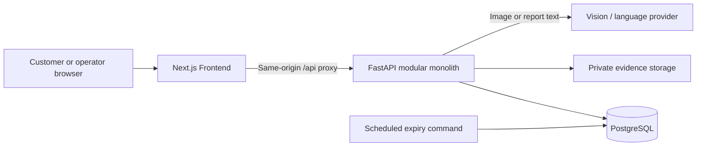

# Guardian system architecture

## Repository facts and proposed shape

Nemo has `Frontend/` with Next.js 16.4.6, React 19.3.0, TypeScript, Tailwind 4, next-intl, Redux UI state and shared components. At inspected dev commit 6f96e51, transfer/operator screens use local mock data and decisions. The backend implements health/errors/settings, lazy DB sessions, migration scaffolding, Docker and launchers; domain APIs are not implemented. Preserve the installed package/lockfile pairing unless a verified failure justifies a targeted change.

Read `Frontend/AGENTS.md` and relevant bundled Next documentation under `node_modules/next/dist/docs/` before implementation. The frontend README describes an intended `components/shared/` directory that is not present at the inspected commit. Create a shared component only when an actual use requires it.



Deploy the Next.js server and FastAPI as two Cloud Run services. The frontend is public and the API requires the frontend service identity. Browser requests use the frontend origin and `/api` is forwarded by a Next route handler to the configured API origin. Forward actor cookies, CSRF and Origin, preserve multiple Set-Cookie headers and error responses, and disable caching for session/financial/evidence routes. Attach a Google ID token server-side with the API URL as audience. Do not forward browser-controlled identity headers or upstream Authorization values.

FastAPI independently authenticates every application call after Cloud Run verifies service identity. The local-development route can skip Google ID-token authentication when using a loopback backend; application authorization remains mandatory. Configure Origin checks against the exact public frontend origin. [cloud-deployment.md](cloud-deployment.md) specifies provisioning, IAM, secret versions, image release, migration/maintenance jobs, smoke checks and rollback.

Use one managed PostgreSQL with TLS and a bounded pool. The cloud plan proposes Neon PostgreSQL as the default and Supabase direct/session PostgreSQL as the alternative. Separate development/demo data and verify transaction/advisory-lock compatibility and plan quotas. Store uploaded evidence in private Neon Object Storage through an S3 adapter (boto3); configure its branch endpoint/region and scoped credentials separately from the database URL. Only the backend serves evidence after ownership checks. The app's API key/DB credentials live in deployment secrets. Verify a billed provider call and cloud credit eligibility early.

## Source map

```text
Backend/
  pyproject.toml
  alembic.ini
  app/
    main.py
    settings.py
    db.py
    errors.py
    maintenance.py     one-shot hold/AI-run expiry and retention command
    auth/              actor sessions, demo control, CSRF
    demo/              scenario fixtures, approved refund settlement
    transfers/         draft, ledger, reservations, confirm/cancel/expiry
    risk/              deterministic evaluator, assessment fingerprints
    evidence/          upload validation, restricted evidence serving
    investigation/     AI adapter, extraction, report grouping, tracing
    operations/        reports, holds, recipient restrictions, notices
    models.py          initial SQLAlchemy models; split by domain when useful
  migrations/versions/
  tests/               behavior tests using PostgreSQL
Frontend/src/features/
  transfers/           customer transfer, optional analysis, notices
  investigations/      operator queues, evidence detail, decision actions
  demo/                sandbox and seeded-actor toolbar
Frontend/src/lib/
  api-client.ts        typed API access and consistent errors
    backend-proxy.ts     fixed upstream and cloud ID-token forwarding
Frontend/src/app/api/[...path]/route.ts
                         same-origin dynamic API route handler
```

Use feature `components/`, `hooks/`, `services/`, `types/`, `mocks/` conventions already present. Routes stay thin. Reuse existing tokens, tables, dialogs, alerts and page layout. Create corresponding `en` and `vi` namespaces and run strict namespace generation. New business logic belongs in feature services/hooks, with server-authoritative outcomes. Redux remains appropriate for UI preferences; payment state comes from API results.

## Backend boundaries

| Module | Responsibility | Dependencies |
| --- | --- | --- |
| Auth/demo | Establish sandbox and actor context | DB, fixtures |
| Transfers | Monetary state machine and account locks | Risk evaluator, audit |
| Risk | Assess known facts and return independent reasons | Settled history, active restrictions |
| Evidence | Validate/store/serve uploads | Auth, private storage |
| Investigation | Run model, validate output, trace exact references | Evidence, reports, issued references |
| Operations | Authorized case/restriction/hold/notice decisions | Transfers, investigation, audit |

HTTP handlers validate input and resolve identity. Services own transaction boundaries. Use SQLAlchemy directly within services initially. Add repositories only when repeated queries justify them. Reserve a provider adapter for AI and evidence storage. The synthetic ledger is the core payment implementation. An external payment provider introduces uncertain outcomes and must get a separate state-machine design before adoption.

## Session design

`POST /api/v1/demo/sessions` creates a sandbox, opaque `guardian_demo` controller cookie and an initial customer `guardian_session` cookie. Both tokens are random and stored only as hashes. Return CSRF tokens for the controller and selected actor in the JSON bootstrap. `POST /demo/actors/select` requires controller authentication, controller CSRF, and membership validation; it issues a new actor cookie and actor CSRF token.

The actor cookie maps to a server-side CUSTOMER or OPERATOR. Controller credentials only grant access to synthetic demo controls and actor selection within their sandbox. Passing another sandbox ID or a chosen `X-Actor-Role` grants nothing. Cookie lifetimes and sandbox lifetimes are 24 hours by default. Production employee/customer authentication is a later integration behind the same resolved-principal interface.

All mutating actor endpoints verify actor CSRF and Origin. Demo controls verify controller CSRF and Origin. Same-origin mode avoids third-party cookie dependence. Selecting a new actor updates the frontend query state and clears previous actor data from memory. Multiple tabs in one browser share cookies; display the current actor and invalidate stale cached identity before actions. Independent sandbox tests use separate browser contexts.

## AI boundary

Use a provider adapter and bounded runner, specified in [ai-investigation.md](ai-investigation.md):

- `ReasoningModel.next(messages, tool_schemas, remaining_seconds) -> ModelTurn` returns proposed tool calls or a final structured payload.
- `InvestigationRunner.run(context: InvestigationContext) -> InvestigationRunResult` owns the shared deadline, three-request/four-tool budget and source validation. It never receives a general SQL/shell or mutation tool.
- `ToolGateway.execute(context, call) -> ToolReceipt` validates arguments, role and scope on every call, issues run-local source IDs and limits response size. Customer and operator registries are separate.

Customer tools read only the run's explicitly linked owned order/refund/transfer facts. Ops tools read the root case, bounded related reports, exact reference lookups and access events for batches established in that run. Backend exact trace remains independently available without AI. No model-selected actor/sandbox can widen retrieval.

Persist PENDING in a short transaction, release it before model/object-store calls, perform each scoped tool read in a short session, and finalize SUCCEEDED/FAILED/TIMED_OUT afterwards. Keep all loop requests/retries within 20 seconds and count each actual provider request. Retain source receipts/snapshots in ai_runs.output; no new physical table is required.

Analysis/Investigation gain optional nullable dossier in OpenAPI 1.1. It contains validated findings/sources, completed activity, recommended checks, limitations and citation warnings. Do not return raw tool arguments, unrestricted logs or chain-of-thought. A malformed or unsupported claim cannot authorize money or a public restriction. The server composes customer verdicts using validated action interpretation and official facts.

Core uses synchronous responses and loading states; no chat or streaming endpoints. Inject fake adapters for repeatable tests, then separately prove live provider/storage behavior. Provider/model remain configurable; no billing upgrade or live credential is implied by this design.

## Extension points

- Additional risk rules implement the same pure evaluator input/output contract and preserve individual reason codes.
- New evidence channels normalize into a report and AI run with source provenance. Access is granted by a channel adapter.
- New authentication replaces session establishment, while the principal's actor, sandbox/tenant and permissions remain server-resolved.
- A future production tenant is an owning organization, distinct from an expiring sandbox. Introduce that ownership explicitly in a migration.
- Add asynchronous jobs only if actual analysis latency/throughput needs them. Persist job IDs/status and completion identity before introducing workers.
- Future agent tools are narrow, read-only retrieval functions unless a separate authorization design approves mutations. The current inference pipeline is sufficient for core scope.

## Operational controls

Use structured request IDs and record state-changing events with actor, reason and evidence IDs. Exclude raw screenshots, session tokens, API keys and full account identifiers from ordinary logs. Configure upload limits, sandbox quotas, model-call quotas and cleanup retention. For the contest default, allow 20 analysis runs and 5 operator investigation runs per sandbox per hour plus 300 actual provider requests per UTC day deployment-wide. Existing GROUP_SANDBOX_HOURLY_LIMIT names the operator investigation budget; each tool-loop request and retry counts against the actual provider budget. Preserve a normal transfer path when the provider quota is exhausted.

Deployment remains reproducible from committed source and locked dependencies. Freeze the submitted revision and keep the live app reachable throughout judging. Collect health, provider failures, unprocessed holds and database connectivity signals. Maintain an expiry sweep every minute; use Cloud Scheduler/Job execution identity with direct DB access instead of a public unauthenticated cleanup endpoint.
