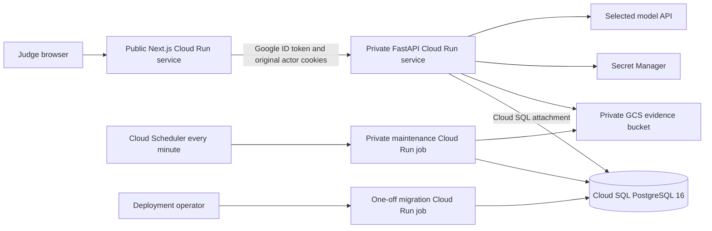

# Guardian cloud deployment and operations plan

This is the executable deployment plan for the application described in this pack. Container images, application commands and cloud access must be verified during implementation. The commands below have not provisioned resources. Run shell examples in Google Cloud Shell using Bash after the referenced application files exist.

## 1. Target topology and owners



| Resource | Proposed name | Owner and responsibility |
| --- | --- | --- |
| GCP project | Existing team project selected on Day 1 | Dev A checks billing, credit eligibility, APIs and IAM |
| Region | `asia-southeast1` | Both services, SQL, bucket and jobs use this region |
| Artifact Registry | `guardian` | Dev A stores images tagged by commit SHA |
| Frontend service | `guardian-web` | Dev B supplies Next server image and authenticated API proxy |
| Backend service | `guardian-api` | Dev A supplies API image and runtime configuration |
| SQL instance / database | `guardian-pg` / `guardian` | Dev A owns migrations, access, backup and recovery |
| Evidence bucket | `<project-id>-guardian-evidence` | Backend serves authenticated evidence; public access prevention enabled |
| Migration job | `guardian-migrate` | Deployment operator runs exactly once per schema release |
| Maintenance job | `guardian-maintenance` | Expiry, stale AI-run reconciliation and expired-sandbox cleanup |
| Scheduler | `guardian-maintenance-minute` | Invokes maintenance with a dedicated identity |
| Secrets | See environment matrix | Versioned DB URLs and model credentials |

Cloud SQL is the proposed primary database to use the reported GCP credit and keep services together. An existing Neon/Supabase PostgreSQL can be used if that is already available and materially improves the verified budget. Record that choice before Task 2. In that alternative use TLS DATABASE_URL, remove Cloud SQL attachment/IAM commands, and ensure the selected pool mode supports transactions and PostgreSQL advisory locks. A change of database host does not change the API or table definitions.

## 2. Cloud release prerequisites

- Both images pass local checks and are built from the same recorded source revision.
- Next runs as a server and listens on `0.0.0.0:$PORT`; FastAPI also binds the Cloud Run port. Build-time frontend constants must not embed server secrets.
- The Next `/api/[...path]` route forwards only to the configured API URL, attaches a Google ID token with that URL as audience, forwards actor/demo cookies and CSRF/Origin, and preserves multiple Set-Cookie headers. Use `google-auth-library` server-side after verifying compatibility with the installed Next version. Limit upload/request size and reject arbitrary upstream destinations.
- The API independently checks actor permissions and CSRF even though Cloud Run requires the frontend service identity. Local development can disable the Google ID-token layer for a loopback backend; application permissions remain enforced.
- The backend image includes Alembic and the maintenance command. Neither schema migration nor fixture seeding runs on ordinary service startup.
- The app uses private GCS object keys, stable DB persistence and startup-safe connection pools. No uploaded evidence depends on the container filesystem.

Cloud Run supplies PORT and expects the ingress container to listen on the appropriate interface. Next requires a server-capable image for this topology. [Cloud Run container contract](https://docs.cloud.google.com/run/docs/container-contract)

## 3. Runtime configuration

| Variable / secret | Consumer | Proposed value or source | Meaning |
| --- | --- | --- | --- |
| `APP_ENV` | API, jobs | `production` | Secure cookies and production error handling |
| `PORT` | Both services | Cloud Run injects `8080` | Container listener |
| `PUBLIC_APP_ORIGIN` | API | Exact frontend HTTPS origin | Origin and CSRF validation |
| `API_BASE_URL` | Next server | Exact private API Cloud Run URL | Upstream fixed by configuration |
| `API_REQUIRE_ID_TOKEN` | Next server | `true` in cloud | Attach frontend service identity token |
| `DATABASE_URL` | API, migration, maintenance | Different versioned Secret Manager secrets | Restricted app, migration owner or maintenance connection respectively |
| `DB_POOL_SIZE` | API | `3` initially | Connections per container process |
| `DB_MAX_OVERFLOW` | API | `2` initially | Bounded overflow, checked against total DB limit |
| `EVIDENCE_BUCKET` | API, maintenance | Private bucket name | Original evidence object store |
| `AI_PROVIDER`, `AI_MODEL` | API | Chosen after live smoke call | Actual inference integration |
| `AI_API_KEY` | API | Secret Manager | Provider credential, never a NEXT_PUBLIC value |
| `AI_TIMEOUT_SECONDS` | API | `20` | Total inference deadline including retry |
| `HOLD_TTL_SECONDS` | API, maintenance | `900` | Hold lifetime |
| `DRAFT_TTL_SECONDS` | API, maintenance | `1800` | Draft lifetime |
| `ASSESSMENT_TTL_SECONDS` | API | `300` | Acknowledgement lifetime |
| `AI_SANDBOX_HOURLY_LIMIT` | API | `20` | Analysis requests per sandbox per hour |
| `GROUP_SANDBOX_HOURLY_LIMIT` | API | `5` | Grouping requests per sandbox per hour |
| `AI_DAILY_GLOBAL_LIMIT` | API | `300` initially | Application provider-call cap, adjustable after measured use |

The implementation must use these names consistently in settings, environment examples and deployment files. A provider using workload identity may replace AI_API_KEY with its scoped service permissions; record that decision and remove unused key configuration. Never log secret values or complete connection URLs.

Store DB URLs using the SQLAlchemy psycopg driver form `postgresql+psycopg://`. For a Cloud SQL Unix socket connection, URI-encode credentials and use the configured `/cloudsql/<instance-connection-name>` host path. Verify the selected SQLAlchemy/psycopg connection format with a migration before release. The API, migration job and maintenance job use separate database users. Cloud SQL attachments and connection pooling require explicit configuration. [Cloud SQL connection guide](https://docs.cloud.google.com/sql/docs/postgres/connect-run)

## 4. Provision resources

Examples below use placeholders and non-secret names. Select an existing billed project before execution. Confirm the chosen SQL machine's current price and credit eligibility in the billing console.

```bash
export PROJECT_ID='replace-with-team-project'
export REGION='asia-southeast1'
export SQL_INSTANCE='guardian-pg'
export BUCKET="${PROJECT_ID}-guardian-evidence"
export REGISTRY="${REGION}-docker.pkg.dev/${PROJECT_ID}/guardian"

gcloud config set project "$PROJECT_ID"
gcloud services enable run.googleapis.com artifactregistry.googleapis.com cloudbuild.googleapis.com sqladmin.googleapis.com secretmanager.googleapis.com storage.googleapis.com cloudscheduler.googleapis.com

gcloud artifacts repositories create guardian --repository-format=docker --location="$REGION"

gcloud sql instances create "$SQL_INSTANCE" --database-version=POSTGRES_16 --edition=ENTERPRISE --tier=db-custom-1-3840 --region="$REGION" --availability-type=zonal --storage-type=SSD --storage-size=10 --storage-auto-increase --storage-auto-increase-limit=20 --backup-start-time=18:00 --deletion-protection

gcloud sql databases create guardian --instance="$SQL_INSTANCE"

gcloud storage buckets create "gs://${BUCKET}" --location="$REGION" --uniform-bucket-level-access
gcloud storage buckets update "gs://${BUCKET}" --public-access-prevention

for account in guardian-web guardian-api guardian-migrate guardian-maintenance guardian-scheduler; do
  gcloud iam service-accounts create "$account"
done
```

These create commands are first-provisioning examples. For an existing resource inspect its configuration instead of blindly recreating it. The SQL choice is a single-zone starting point, not a price guarantee. Changing the region requires updating names, connection path and image URLs together. Cloud SQL versions and editions can affect supported configurations. [SQL instance creation](https://docs.cloud.google.com/sql/docs/postgres/create-instance)

Use the Cloud SQL console or an authorized admin session to create `guardian_app`, `guardian_migrate` and `guardian_maintenance` users with unique passwords. Migration owns application objects. The application needs table reads, intended business updates and ledger/audit inserts, with no routine update/delete permission on ledger/audit. Maintenance additionally needs expired-sandbox cleanup permissions. Configure matching default privileges for future migrations.

Create Secret Manager secrets `guardian-app-database-url`, `guardian-migration-database-url`, `guardian-maintenance-database-url` and `guardian-ai-api-key`. Add values through the secure console or a protected local input file. Pin secret version numbers in the release manifest; the examples assume version `1`. Passwords and secret contents are absent from shell history and source control.

## 5. Grant runtime access

```bash
export WEB_SA="guardian-web@${PROJECT_ID}.iam.gserviceaccount.com"
export API_SA="guardian-api@${PROJECT_ID}.iam.gserviceaccount.com"
export MIGRATE_SA="guardian-migrate@${PROJECT_ID}.iam.gserviceaccount.com"
export MAINT_SA="guardian-maintenance@${PROJECT_ID}.iam.gserviceaccount.com"
export SCHED_SA="guardian-scheduler@${PROJECT_ID}.iam.gserviceaccount.com"

for account in "$API_SA" "$MIGRATE_SA" "$MAINT_SA"; do
  gcloud projects add-iam-policy-binding "$PROJECT_ID" --member="serviceAccount:${account}" --role=roles/cloudsql.client
done

gcloud secrets add-iam-policy-binding guardian-app-database-url --member="serviceAccount:${API_SA}" --role=roles/secretmanager.secretAccessor
gcloud secrets add-iam-policy-binding guardian-ai-api-key --member="serviceAccount:${API_SA}" --role=roles/secretmanager.secretAccessor
gcloud secrets add-iam-policy-binding guardian-migration-database-url --member="serviceAccount:${MIGRATE_SA}" --role=roles/secretmanager.secretAccessor
gcloud secrets add-iam-policy-binding guardian-maintenance-database-url --member="serviceAccount:${MAINT_SA}" --role=roles/secretmanager.secretAccessor

gcloud storage buckets add-iam-policy-binding "gs://${BUCKET}" --member="serviceAccount:${API_SA}" --role=roles/storage.objectUser
gcloud storage buckets add-iam-policy-binding "gs://${BUCKET}" --member="serviceAccount:${MAINT_SA}" --role=roles/storage.objectUser
```

Give the deployment operator only the administration/build/service-account-use permissions needed to create and release these resources. Build execution identity depends on project settings; verify its Artifact Registry write permission and build-log destination if a build fails. Runtime services do not need project Owner/Editor.

Private bucket access is granted to service identities; browser evidence reads go through the authenticated API. Enforce uniform bucket-level access and public access prevention. [GCS uniform access](https://docs.cloud.google.com/storage/docs/uniform-bucket-level-access) · [Public access prevention](https://docs.cloud.google.com/storage/docs/public-access-prevention)

## 6. Build, migrate and deploy in order

Run from the repository root after the Dockerfiles exist and tests pass. The backend Dockerfile uses Backend as its build context and frontend uses Frontend.

```bash
export RELEASE_SHA="$(git rev-parse --short=12 HEAD)"
export API_IMAGE="${REGISTRY}/api:${RELEASE_SHA}"
export WEB_IMAGE="${REGISTRY}/web:${RELEASE_SHA}"
export SQL_CONNECTION="${PROJECT_ID}:${REGION}:${SQL_INSTANCE}"

gcloud builds submit ./Backend --tag="$API_IMAGE"
gcloud builds submit ./Frontend --tag="$WEB_IMAGE"

gcloud run jobs deploy guardian-migrate --image="$API_IMAGE" --region="$REGION" --service-account="$MIGRATE_SA" --set-cloudsql-instances="$SQL_CONNECTION" --set-secrets=DATABASE_URL=guardian-migration-database-url:1 --set-env-vars=APP_ENV=production --command=python --args=-m,alembic,upgrade,head --tasks=1 --parallelism=1 --max-retries=0 --task-timeout=300s

gcloud run jobs execute guardian-migrate --region="$REGION" --wait
```

Stop the release if migration fails. Check the migration execution result and schema version. Never run one migration per web container. Alembic must be able to load the database settings without requiring a model key or frontend origin. Record a pre-migration backup for releases that change an existing schema.

First deploy the private API using a deliberately nonmatching temporary app origin. This denies browser mutations until the final frontend URL is known. The image must already contain its actual provider adapter; replace provider/model variables after the smoke-call choice.

```bash
export AI_PROVIDER='replace-with-implemented-provider'
export AI_MODEL='replace-with-tested-model-id'

gcloud run deploy guardian-api --image="$API_IMAGE" --region="$REGION" --service-account="$API_SA" --no-allow-unauthenticated --add-cloudsql-instances="$SQL_CONNECTION" --set-secrets=DATABASE_URL=guardian-app-database-url:1,AI_API_KEY=guardian-ai-api-key:1 --set-env-vars="APP_ENV=production,PUBLIC_APP_ORIGIN=https://bootstrap.invalid,EVIDENCE_BUCKET=${BUCKET},AI_PROVIDER=${AI_PROVIDER},AI_MODEL=${AI_MODEL},DB_POOL_SIZE=3,DB_MAX_OVERFLOW=2,AI_TIMEOUT_SECONDS=20,HOLD_TTL_SECONDS=900,DRAFT_TTL_SECONDS=1800,ASSESSMENT_TTL_SECONDS=300,AI_SANDBOX_HOURLY_LIMIT=20,GROUP_SANDBOX_HOURLY_LIMIT=5,AI_DAILY_GLOBAL_LIMIT=300" --port=8080 --cpu=1 --memory=512Mi --concurrency=20 --min-instances=0 --max-instances=2 --timeout=60s

export API_URL="$(gcloud run services describe guardian-api --region="$REGION" --format='value(status.url)')"

gcloud run services add-iam-policy-binding guardian-api --region="$REGION" --member="serviceAccount:${WEB_SA}" --role=roles/run.invoker

gcloud run deploy guardian-web --image="$WEB_IMAGE" --region="$REGION" --service-account="$WEB_SA" --allow-unauthenticated --set-env-vars="API_BASE_URL=${API_URL},API_REQUIRE_ID_TOKEN=true" --port=8080 --cpu=1 --memory=512Mi --concurrency=20 --min-instances=0 --max-instances=2 --timeout=60s

export WEB_URL="$(gcloud run services describe guardian-web --region="$REGION" --format='value(status.url)')"

gcloud run services update guardian-api --region="$REGION" --update-env-vars="PUBLIC_APP_ORIGIN=${WEB_URL}"

curl --fail-with-body "${WEB_URL}/api/v1/health"
```

Validate the frontend timeout/proxy can wait for the bounded 20-second model call. Keep connection pools bounded to the DB capacity, including old/new revisions during rollout and migration/maintenance connections. Request concurrency above is a starting configuration, subject to measured memory, DB and provider behavior. [Deploying images](https://docs.cloud.google.com/run/docs/deploying) · [Service identity authentication](https://docs.cloud.google.com/run/docs/authenticating/service-to-service) · [Secret injection](https://docs.cloud.google.com/run/docs/configuring/services/secrets)

## 7. Expiry and retention job

Implement `Backend/app/maintenance.py` as an idempotent one-shot CLI. Invocation `python -m app.maintenance` expires due drafts/holds using the shared transfer service, marks abandoned PENDING AI runs TIMED_OUT, and removes expired sandbox evidence/data after the retention grace period. Start stale-AI reconciliation at 120 seconds so an active 20-second analysis is not interrupted. Multiple executions can overlap safely through database locks.

```bash
gcloud run jobs deploy guardian-maintenance --image="$API_IMAGE" --region="$REGION" --service-account="$MAINT_SA" --set-cloudsql-instances="$SQL_CONNECTION" --set-secrets=DATABASE_URL=guardian-maintenance-database-url:1 --set-env-vars="APP_ENV=production,EVIDENCE_BUCKET=${BUCKET},HOLD_TTL_SECONDS=900,DRAFT_TTL_SECONDS=1800" --command=python --args=-m,app.maintenance --tasks=1 --parallelism=1 --max-retries=1 --task-timeout=120s

gcloud run jobs add-iam-policy-binding guardian-maintenance --region="$REGION" --member="serviceAccount:${SCHED_SA}" --role=roles/run.invoker

gcloud run jobs execute guardian-maintenance --region="$REGION" --wait

gcloud scheduler jobs create http guardian-maintenance-minute --location="$REGION" --schedule='* * * * *' --time-zone='Asia/Bangkok' --uri="https://run.googleapis.com/v2/projects/${PROJECT_ID}/locations/${REGION}/jobs/guardian-maintenance:run" --http-method=POST --oauth-service-account-email="$SCHED_SA" --message-body='{}'
```

The Scheduler calls the authenticated Google API using OAuth. Confirm one actual scheduled execution and its job result. Endpoint reconciliation still checks deadlines when the scheduled execution is delayed. A Cloud Run web process's idle background loop is insufficient to guarantee expiry. [Scheduling Cloud Run jobs](https://docs.cloud.google.com/run/docs/execute/jobs-on-schedule)

## 8. Hosted acceptance gates

| Gate | Check | Owner |
| --- | --- | --- |
| Runtime | Both services bind PORT, start without embedded secrets and pass health through the frontend origin | Dev A/B |
| Private API | Unauthenticated direct API request is denied; frontend identity reaches it successfully | Dev A |
| Sessions | Bootstrap sets cookies through the proxy; CSRF is honored; switching actors updates visible data | Dev B |
| Data | Migration version is head; two fresh sandboxes remain isolated after service restart | Dev A |
| Evidence | Valid upload persists across restart; public bucket URL and another sandbox cannot read it | Dev A/B |
| AI | Live model call succeeds with measured latency; timeout still permits cancellation and official facts | Dev B |
| Money | Hold, cancel, clearance/reconfirm, expiry and refund replay maintain exact balances | Dev A |
| Maintenance | One scheduled job actually expires a due test hold and releases its reservation | Dev A |
| Demo | BA completes MAIN_REFUND without developer narration; notices reach only the derived cohort | BA |
| Delivery | Live URL works from a clean browser; guide/video use the same submitted revision | All |

## 9. Cost and monitoring

The team reported roughly USD 200 GCP credit. Verify current balance, expiry and service eligibility in billing. The following is a planning allocation, not quoted cloud pricing.

| Item | Planning allocation |
| --- | --- |
| Cloud Run services and scheduled jobs | USD 25 |
| Cloud SQL, disk and backups | USD 60 |
| Registry, builds, storage, logs and network | USD 15 |
| Runtime model calls, if eligible for the credit | USD 40 |
| Unallocated buffer | USD 60 |

If model calls are billed elsewhere, record that separately. Inspect actual costs daily, especially continuous SQL charges and maintenance-job startup frequency. Default services scale to zero, with a maximum of two instances each. One warm frontend/API instance during judging is an optional measured cost decision. Limits at the provider account should complement application quotas.

Set billing alerts at 50%, 80% and 95% of the agreed budget. An alerts-only budget does not cap spending; use explicit instance/call/storage limits and review spend-cap availability in the actual account. [Cloud Billing budgets](https://docs.cloud.google.com/billing/docs/how-to/budgets)

Monitor service 5xx, provider timeouts/quota failures, pool exhaustion, failed job executions, due-held transfers and storage cleanup errors. Keep a release log with image digests, migration head, secret version references, service revision IDs, job image and public URL. Redact raw customer text, account numbers and credentials from routine logs.

## 10. Release, rollback and judging availability

1. Run local/build/behavior checks and save evaluation results before tagging the release.
2. Make additive DB changes before deploying callers that require them. Keep prior service revisions compatible until rollback is no longer needed.
3. Record both service revision names and image digests. If a new revision fails, route traffic to the last known compatible revision with `gcloud run services update-traffic <service> --region="$REGION" --to-revisions=<previous-revision>=100`.
4. App rollback does not reverse DB writes or migrations. For a destructive migration, review a restore/roll-forward plan before executing it. Prefer additive changes during the contest.
5. A database recovery uses a backup restored to a separate instance, validation of the restored data, then updated versioned secrets/attachments and service revisions. Verify all sessions/hold deadlines after recovery.
6. Keep the submitted frontend/API images and schema revision reachable through the judging period. Record submission at 3 December 2026, 23:59:59 Asia/Bangkok; the local rules list online judging during 4–11 December. Freeze the submitted artifact rather than letting a routine dev push silently replace it.
7. After judging, review budget, retention and archive requirements before removing resources. Database deletion protection prevents an accidental instance removal. Resource cleanup is a deliberate separate operation.

## 11. Troubleshooting

| Symptom | Likely checks |
| --- | --- |
| Frontend page loads but API proxy returns 403 | API URL audience, frontend service account run.invoker binding, ID-token attachment |
| Bootstrap succeeds but next action is 401/403 | Multiple Set-Cookie forwarding, cookie path/Secure flags, actor CSRF, allowed public Origin |
| Cloud Run cannot start | PORT/interface binding, runtime entry point, required secret accessor permission, application logs |
| API cannot connect to DB | SQL attachment, Cloud SQL Client role, database-user grants, URI encoding, connection path and pool capacity |
| First model call fails | Provider access, selected model ID/region, key version, provider billing and quota |
| Evidence disappears after deploy | Uploaded to ephemeral disk instead of private GCS, or object scope/path mismatch |
| Held balance never releases | Job IAM/schedule execution, shared expiry transaction, endpoint reconciliation and database time |
| Corrected policy still holds transfer | Existing held instruction requires explicit review/cancel; revocation alone does not send money |
