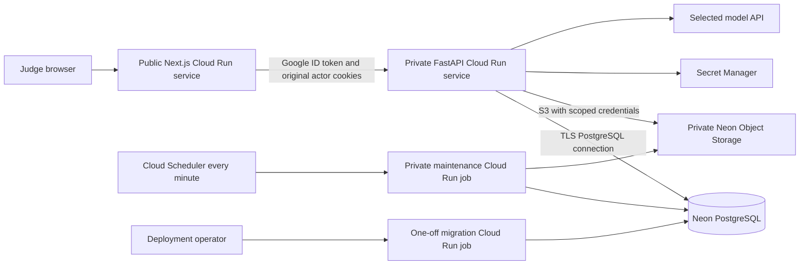

# Guardian cloud deployment and operations plan

This is the executable deployment plan for the application described in this pack. Container images, application commands and cloud access must be verified during implementation. The commands below have not provisioned resources. Run shell examples in Google Cloud Shell using Bash after the referenced application files exist.

## 1. Target topology and owners



| Resource | Proposed name | Owner and responsibility |
| --- | --- | --- |
| GCP project | Existing team project selected on Day 1 | Dev A checks billing, credit eligibility, APIs and IAM |
| Region | `asia-southeast1` | GCP services use this region; choose a nearby database region where available |
| Artifact Registry | `guardian` | Dev A stores images tagged by commit SHA |
| Frontend service | `guardian-web` | Dev B supplies Next server image and authenticated API proxy |
| Backend service | `guardian-api` | Dev A supplies API image and runtime configuration |
| Managed PostgreSQL | Neon project with separate dev/demo branches | Dev A owns migrations, access, quotas and recovery |
| Evidence bucket | `uploads` in the selected Neon branch | Private bucket; evidence served after ownership checks |
| Migration job | `guardian-migrate` | Deployment operator runs exactly once per schema release |
| Maintenance job | `guardian-maintenance` | Expiry, stale AI-run reconciliation and expired-sandbox cleanup |
| Scheduler | `guardian-maintenance-minute` | Invokes maintenance with a dedicated identity |
| Secrets | See environment matrix | Versioned DB URLs and model credentials |

Neon is the proposed default managed PostgreSQL and Supabase is the supported alternative. Both publish free plans with resource and availability limits. Create separate development and judging databases/branches. GCP credits apply to eligible GCP services; external database billing is separate. [Neon pricing](https://neon.com/pricing) · [Supabase pricing](https://supabase.com/pricing)

Use direct PostgreSQL initially. Supabase's session pooler is an alternative when direct reachability requires it. Transaction poolers need a deliberate compatibility test for the planned transaction-scoped advisory locks, prepared statements and migration behavior. [Neon pooling](https://neon.com/docs/connect/connection-pooling) · [Supabase connections](https://supabase.com/docs/guides/database/connecting-to-postgres)

## 2. Cloud release prerequisites

- Both images pass local checks and are built from the same recorded source revision.
- Next runs as a server and listens on `0.0.0.0:$PORT`; FastAPI also binds the Cloud Run port. Build-time frontend constants must not embed server secrets.
- The Next `/api/[...path]` route forwards only to the configured API URL, attaches a Google ID token with that URL as audience, forwards actor/demo cookies and CSRF/Origin, and preserves multiple Set-Cookie headers. Use `google-auth-library` server-side after verifying compatibility with the installed Next version. Limit upload/request size and reject arbitrary upstream destinations.
- The API independently checks actor permissions and CSRF even though Cloud Run requires the frontend service identity. Local development can disable the Google ID-token layer for a loopback backend; application permissions remain enforced.
- The backend image includes Alembic and the maintenance command. Neither schema migration nor fixture seeding runs on ordinary service startup.
- The app uses private Neon S3 object keys, stable DB persistence and startup-safe connection pools. No uploaded evidence depends on the container filesystem.

Cloud Run supplies PORT and expects the ingress container to listen on the appropriate interface. Next requires a server-capable image for this topology. [Cloud Run container contract](https://docs.cloud.google.com/run/docs/container-contract)

## 3. Runtime configuration

The S3 adapter and bounded-runner settings below are planned; they are not implemented by this documentation revision. Use these commands only after the corresponding application tasks and local checks pass.

| Variable / secret | Consumer | Proposed value or source | Meaning |
| --- | --- | --- | --- |
| `APP_ENV` | API, jobs | `production` | Secure cookies and production error handling |
| `PORT` | Both services | Cloud Run injects `8080` | Container listener |
| `PUBLIC_APP_ORIGIN` | API | Exact frontend HTTPS origin | Origin and CSRF validation |
| `API_BASE_URL` | Next server | Exact private API Cloud Run URL | Upstream fixed by configuration |
| `API_REQUIRE_ID_TOKEN` | Next server | `true` in cloud | Attach frontend service identity token |
| `DATABASE_URL` | API, migration, maintenance | Different versioned Secret Manager secrets | Restricted app, migration owner or maintenance connection respectively |
| `DB_POOL_SIZE` | API | `3` initially | Connections per container process |
| `DB_MAX_OVERFLOW` | API | `2` initially | Bounded overflow, checked against total DB limit |
| `EVIDENCE_BUCKET` | API, maintenance | Private Neon bucket name | Original evidence object store |
| `EVIDENCE_STORE` | API, maintenance | `s3` | Planned storage adapter |
| `AWS_ENDPOINT_URL_S3`, `AWS_REGION` | API, maintenance | Selected Neon branch endpoint/region | Planned custom S3 endpoint and path-style addressing |
| `AWS_ACCESS_KEY_ID`, `AWS_SECRET_ACCESS_KEY` | API, maintenance | Versioned Secret Manager secrets | Scoped Neon storage credentials, never browser variables |
| `AI_PROVIDER`, `AI_MODEL` | API | Chosen after live smoke call | Actual inference integration |
| `AI_API_KEY` | API | Secret Manager | Provider credential, never a NEXT_PUBLIC value |
| `AI_TIMEOUT_SECONDS` | API | `20` | Shared deadline for all model requests, tools and retry |
| `AI_MAX_MODEL_REQUESTS`, `AI_MAX_TOOL_CALLS` | API | `3`, `4` | Planned model-request/tool-execution caps per logical run |
| `AI_MAX_OUTPUT_TOKENS` | API | `1600` | Planned per-request output cap; measure truncation |
| `HOLD_TTL_SECONDS` | API, maintenance | `900` | Hold lifetime |
| `DRAFT_TTL_SECONDS` | API, maintenance | `1800` | Draft lifetime |
| `ASSESSMENT_TTL_SECONDS` | API | `300` | Acknowledgement lifetime |
| `AI_SANDBOX_HOURLY_LIMIT` | API | `20` | Analysis requests per sandbox per hour |
| `GROUP_SANDBOX_HOURLY_LIMIT` | API | `5` | Logical Ops investigations per sandbox per hour; historical setting name |
| `AI_DAILY_GLOBAL_LIMIT` | API | `300` initially | Actual outbound model requests/day, including every loop request/retry |

The implementation must use these names consistently in settings, environment examples and deployment files. A provider using workload identity may replace AI_API_KEY with its scoped service permissions; record that decision and remove unused key configuration. Never log secret values or complete connection URLs.

Store DB URLs using `postgresql+psycopg://`, URI-encoded credentials and provider TLS settings, with `sslmode=require` as the baseline. The API, migration job and maintenance job use separate database users. With Supabase, configure exposed schemas/RLS appropriately or disable the unused Data API. The browser uses FastAPI rather than a public database connection.

## 4. Provision resources

Examples below use placeholders and non-secret names. Select an existing billed GCP project and verify the external database's actual quotas before execution.

```bash
export PROJECT_ID='replace-with-team-project'
export REGION='asia-southeast1'
export EVIDENCE_BUCKET='uploads'
export STORAGE_ENDPOINT='https://replace-with-branch-storage-endpoint'
export STORAGE_REGION='ap-southeast-1'
export REGISTRY="${REGION}-docker.pkg.dev/${PROJECT_ID}/guardian"

gcloud config set project "$PROJECT_ID"
gcloud services enable run.googleapis.com artifactregistry.googleapis.com cloudbuild.googleapis.com secretmanager.googleapis.com cloudscheduler.googleapis.com

gcloud artifacts repositories create guardian --repository-format=docker --location="$REGION"


for account in guardian-web guardian-api guardian-migrate guardian-maintenance guardian-scheduler; do
  gcloud iam service-accounts create "$account"
done
```

These create commands are first-provisioning examples. Inspect existing resources before reusing them. In the Neon console, create the project and separate dev/demo branches, then obtain direct TLS connection strings. With Supabase, use separate environments permitted by the plan and direct/session endpoints. Verify PostgreSQL 16+ and extension permissions before migration.

Use a provider-authorized owner connection to create `guardian_app`, `guardian_migrate` and `guardian_maintenance` users with unique passwords. Migration owns application objects. The application needs table reads, intended business updates and ledger/audit inserts, with no routine update/delete permission on ledger/audit. Maintenance additionally needs expired-sandbox cleanup permissions. Configure matching default privileges for future migrations.

In the Neon console, create a private uploads bucket and a branch-scoped storage credential. Copy its actual endpoint/region and use boto3 path-style addressing. Verify upload/read/delete from the backend. Do not make evidence public for model access. [Neon setup](https://neon.com/docs/storage/get-started) and [S3 compatibility](https://neon.com/docs/storage/s3-compatibility).

Create Secret Manager secrets `guardian-evidence-access-key-id`, `guardian-evidence-secret-access-key`, `guardian-app-database-url`, `guardian-migration-database-url`, `guardian-maintenance-database-url` and `guardian-ai-api-key`. Add values through the secure console or a protected local input file. Pin secret version numbers in the release manifest; the examples assume version `1`. Passwords and secret contents are absent from shell history and source control.

## 5. Grant runtime access

```bash
export WEB_SA="guardian-web@${PROJECT_ID}.iam.gserviceaccount.com"
export API_SA="guardian-api@${PROJECT_ID}.iam.gserviceaccount.com"
export MIGRATE_SA="guardian-migrate@${PROJECT_ID}.iam.gserviceaccount.com"
export MAINT_SA="guardian-maintenance@${PROJECT_ID}.iam.gserviceaccount.com"
export SCHED_SA="guardian-scheduler@${PROJECT_ID}.iam.gserviceaccount.com"

gcloud secrets add-iam-policy-binding guardian-app-database-url --member="serviceAccount:${API_SA}" --role=roles/secretmanager.secretAccessor
gcloud secrets add-iam-policy-binding guardian-ai-api-key --member="serviceAccount:${API_SA}" --role=roles/secretmanager.secretAccessor
gcloud secrets add-iam-policy-binding guardian-migration-database-url --member="serviceAccount:${MIGRATE_SA}" --role=roles/secretmanager.secretAccessor
gcloud secrets add-iam-policy-binding guardian-maintenance-database-url --member="serviceAccount:${MAINT_SA}" --role=roles/secretmanager.secretAccessor

for secret in guardian-evidence-access-key-id guardian-evidence-secret-access-key; do
  gcloud secrets add-iam-policy-binding "$secret" --member="serviceAccount:${API_SA}" --role=roles/secretmanager.secretAccessor
  gcloud secrets add-iam-policy-binding "$secret" --member="serviceAccount:${MAINT_SA}" --role=roles/secretmanager.secretAccessor
done

```

Give the deployment operator only the administration/build/service-account-use permissions needed to create and release these resources. Build execution identity depends on project settings; verify its Artifact Registry write permission and build-log destination if a build fails. Runtime services do not need project Owner/Editor.

GCP service identity authorizes access to Secret Manager. The scoped Neon credential authorizes external S3 storage; GCP IAM does not grant bucket access by itself. Keep the Neon bucket Private and validate resource ownership before serving evidence bytes. API needs storage read/write, maintenance needs read/delete; separate scoped credentials may be introduced before release if supported.

## 6. Build, migrate and deploy in order

Run from the repository root after the Dockerfiles exist and tests pass. The backend Dockerfile uses Backend as its build context and frontend uses Frontend.

```bash
export RELEASE_SHA="$(git rev-parse --short=12 HEAD)"
export API_IMAGE="${REGISTRY}/api:${RELEASE_SHA}"
export WEB_IMAGE="${REGISTRY}/web:${RELEASE_SHA}"

gcloud builds submit ./Backend --tag="$API_IMAGE"
gcloud builds submit ./Frontend --tag="$WEB_IMAGE"

gcloud run jobs deploy guardian-migrate --image="$API_IMAGE" --region="$REGION" --service-account="$MIGRATE_SA" --set-secrets=DATABASE_URL=guardian-migration-database-url:1 --set-env-vars=APP_ENV=production --command=python --args=-m,alembic,upgrade,head --tasks=1 --parallelism=1 --max-retries=0 --task-timeout=300s

gcloud run jobs execute guardian-migrate --region="$REGION" --wait
```

Stop the release if migration fails. Check the migration execution result and schema version. Never run one migration per web container. Alembic must be able to load the database settings without requiring a model key or frontend origin. Record a pre-migration backup for releases that change an existing schema.

First deploy the private API using a deliberately nonmatching temporary app origin. This denies browser mutations until the final frontend URL is known. The image must already contain its actual provider adapter; replace provider/model variables after the smoke-call choice.

```bash
export AI_PROVIDER='replace-with-implemented-provider'
export AI_MODEL='replace-with-tested-model-id'

gcloud run deploy guardian-api --image="$API_IMAGE" --region="$REGION" --service-account="$API_SA" --no-allow-unauthenticated --set-secrets=DATABASE_URL=guardian-app-database-url:1,AI_API_KEY=guardian-ai-api-key:1,AWS_ACCESS_KEY_ID=guardian-evidence-access-key-id:1,AWS_SECRET_ACCESS_KEY=guardian-evidence-secret-access-key:1 --set-env-vars="APP_ENV=production,PUBLIC_APP_ORIGIN=https://bootstrap.invalid,EVIDENCE_STORE=s3,EVIDENCE_BUCKET=${EVIDENCE_BUCKET},AWS_ENDPOINT_URL_S3=${STORAGE_ENDPOINT},AWS_REGION=${STORAGE_REGION},AI_PROVIDER=${AI_PROVIDER},AI_MODEL=${AI_MODEL},DB_POOL_SIZE=3,DB_MAX_OVERFLOW=2,AI_TIMEOUT_SECONDS=20,AI_MAX_MODEL_REQUESTS=3,AI_MAX_TOOL_CALLS=4,AI_MAX_OUTPUT_TOKENS=1600,HOLD_TTL_SECONDS=900,DRAFT_TTL_SECONDS=1800,ASSESSMENT_TTL_SECONDS=300,AI_SANDBOX_HOURLY_LIMIT=20,GROUP_SANDBOX_HOURLY_LIMIT=5,AI_DAILY_GLOBAL_LIMIT=300" --port=8080 --cpu=1 --memory=512Mi --concurrency=20 --min-instances=0 --max-instances=2 --timeout=60s

export API_URL="$(gcloud run services describe guardian-api --region="$REGION" --format='value(status.url)')"

gcloud run services add-iam-policy-binding guardian-api --region="$REGION" --member="serviceAccount:${WEB_SA}" --role=roles/run.invoker

gcloud run deploy guardian-web --image="$WEB_IMAGE" --region="$REGION" --service-account="$WEB_SA" --allow-unauthenticated --set-env-vars="API_BASE_URL=${API_URL},API_REQUIRE_ID_TOKEN=true" --port=8080 --cpu=1 --memory=512Mi --concurrency=20 --min-instances=0 --max-instances=2 --timeout=60s

export WEB_URL="$(gcloud run services describe guardian-web --region="$REGION" --format='value(status.url)')"

gcloud run services update guardian-api --region="$REGION" --update-env-vars="PUBLIC_APP_ORIGIN=${WEB_URL}"

curl --fail-with-body "${WEB_URL}/api/v1/health"
```

Validate the frontend timeout/proxy can wait for the bounded 20-second model call. Keep connection pools bounded to the DB capacity, including old/new revisions during rollout and migration/maintenance connections. Request concurrency above is a starting configuration, subject to measured memory, DB and provider behavior. [Deploying images](https://docs.cloud.google.com/run/docs/deploying) · [Service identity authentication](https://docs.cloud.google.com/run/docs/authenticating/service-to-service) · [Secret injection](https://docs.cloud.google.com/run/docs/configuring/services/secrets)

## 7. Expiry and retention job

Implement `Backend/app/maintenance.py` as an idempotent one-shot CLI. Invocation `python -m app.maintenance` expires due drafts/holds using the shared transfer service, marks abandoned PENDING AI runs TIMED_OUT, and removes expired sandbox evidence/data after the retention grace period. Start stale-AI reconciliation at 120 seconds so an active 20-second analysis is not interrupted. Multiple executions can overlap safely through database locks.

```bash
gcloud run jobs deploy guardian-maintenance --image="$API_IMAGE" --region="$REGION" --service-account="$MAINT_SA" --set-secrets=DATABASE_URL=guardian-maintenance-database-url:1,AWS_ACCESS_KEY_ID=guardian-evidence-access-key-id:1,AWS_SECRET_ACCESS_KEY=guardian-evidence-secret-access-key:1 --set-env-vars="APP_ENV=production,EVIDENCE_STORE=s3,EVIDENCE_BUCKET=${EVIDENCE_BUCKET},AWS_ENDPOINT_URL_S3=${STORAGE_ENDPOINT},AWS_REGION=${STORAGE_REGION},HOLD_TTL_SECONDS=900,DRAFT_TTL_SECONDS=1800" --command=python --args=-m,app.maintenance --tasks=1 --parallelism=1 --max-retries=1 --task-timeout=120s

gcloud run jobs add-iam-policy-binding guardian-maintenance --region="$REGION" --member="serviceAccount:${SCHED_SA}" --role=roles/run.invoker

gcloud run jobs execute guardian-maintenance --region="$REGION" --wait

gcloud scheduler jobs create http guardian-maintenance-minute --location="$REGION" --schedule='* * * * *' --time-zone='Asia/Bangkok' --uri="https://run.googleapis.com/v2/projects/${PROJECT_ID}/locations/${REGION}/jobs/guardian-maintenance:run" --http-method=POST --oauth-service-account-email="$SCHED_SA" --message-body='{}'
```

The Scheduler calls the authenticated Google API using OAuth. Confirm one actual scheduled execution and its job result. Endpoint reconciliation still checks deadlines when the scheduled execution is delayed. A Cloud Run web process's idle background loop is insufficient to guarantee expiry. [Scheduling Cloud Run jobs](https://docs.cloud.google.com/run/docs/execute/jobs-on-schedule)

## 8. Hosted acceptance gates

| Gate | Check | Owner |
| --- | --- | --- |
| Runtime | Both services bind PORT, start without embedded secrets and pass health through the frontend origin | Dev A/B |
| Private API | Unauthenticated direct API request is denied; frontend identity reaches it successfully | Dev A |
| Sessions | Bootstrap sets cookies through the proxy; CSRF is honored; switching actors updates visible data | Dev B |
| Data | Migration version is head; two fresh sandboxes remain isolated after service restart | Dev A |
| Evidence | Valid upload persists across restart; public bucket URL and another sandbox cannot read it | Dev A/B |
| AI | Live model call succeeds with measured latency; timeout still permits cancellation and official facts | Dev B |
| Money | Hold, cancel, clearance/reconfirm, expiry and refund replay maintain exact balances | Dev A |
| Maintenance | One scheduled job actually expires a due test hold and releases its reservation | Dev A |
| Demo | BA completes MAIN_REFUND without developer narration; notices reach only the derived cohort | BA |
| Delivery | Live URL works from a clean browser; guide/video use the same submitted revision | All |

## 9. Cost and monitoring

Verify the reported GCP credit balance and service eligibility. Neon/Supabase and an external model provider have separate billing/quota controls. The free database tier is a starting option; estimate judging traffic and storage before relying on it.

| Service | Cost-control action |
| --- | --- |
| Neon PostgreSQL | Check compute, storage, connection limits and idle behavior for the actual plan |
| Supabase alternative | Check free-project quotas and inactivity pausing before judging |
| Cloud Run | Start at zero minimum/two maximum instances per service and measure maintenance-job startup cost |
| Neon Object Storage, registry and builds | Keep evidence/log retention bounded and inspect image storage |
| Model provider | Enforce quotas and inspect actual token/image costs |

Inspect all provider usage daily. One warm frontend/API instance during judging is an optional measured cost decision. Limits at each provider should complement application quotas.

Set billing alerts at 50%, 80% and 95% of the agreed budget. An alerts-only budget does not cap spending; use explicit instance/call/storage limits and review spend-cap availability in the actual account. [Cloud Billing budgets](https://docs.cloud.google.com/billing/docs/how-to/budgets)

Monitor service 5xx, provider timeouts/quota failures, pool exhaustion, failed job executions, due-held transfers and storage cleanup errors. Keep a release log with image digests, migration head, secret version references, service revision IDs, job image and public URL. Redact raw customer text, account numbers and credentials from routine logs.

## 10. Release, rollback and judging availability

1. Run local/build/behavior checks and save evaluation results before tagging the release.
2. Make additive DB changes before deploying callers that require them. Keep prior service revisions compatible until rollback is no longer needed.
3. Record both service revision names and image digests. If a new revision fails, route traffic to the last known compatible revision with `gcloud run services update-traffic <service> --region="$REGION" --to-revisions=<previous-revision>=100`.
4. App rollback does not reverse DB writes or migrations. For a destructive migration, review a restore/roll-forward plan before executing it. Prefer additive changes during the contest.
5. Database recovery uses the selected provider's available backup/branch capabilities, validation in a separate database, then updated versioned secrets and service revisions. Verify recovery availability for the actual plan and check all sessions/hold deadlines after recovery.
6. Keep the submitted frontend/API images and schema revision reachable through the judging period. Record submission at 3 December 2026, 23:59:59 Asia/Bangkok; the local rules list online judging during 4–11 December. Freeze the submitted artifact rather than letting a routine dev push silently replace it.
7. After judging, review budget, retention, provider recovery and archive requirements before removing resources. Resource cleanup is a deliberate separate operation.

## 11. Troubleshooting

| Symptom | Likely checks |
| --- | --- |
| Frontend page loads but API proxy returns 403 | API URL audience, frontend service account run.invoker binding, ID-token attachment |
| Bootstrap succeeds but next action is 401/403 | Multiple Set-Cookie forwarding, cookie path/Secure flags, actor CSRF, allowed public Origin |
| Cloud Run cannot start | PORT/interface binding, runtime entry point, required secret accessor permission, application logs |
| API cannot connect to DB | Provider project activity, direct/session endpoint, TLS, network reachability, user grants, URI encoding and connection capacity |
| First model call fails | Provider access, selected model ID/region, key version, provider billing and quota |
| Evidence disappears after deploy | Uploaded to ephemeral disk instead of private Neon storage, or wrong branch/endpoint/credential/object scope |
| Held balance never releases | Job IAM/schedule execution, shared expiry transaction, endpoint reconciliation and database time |
| Corrected policy still holds transfer | Existing held instruction requires explicit review/cancel; revocation alone does not send money |
