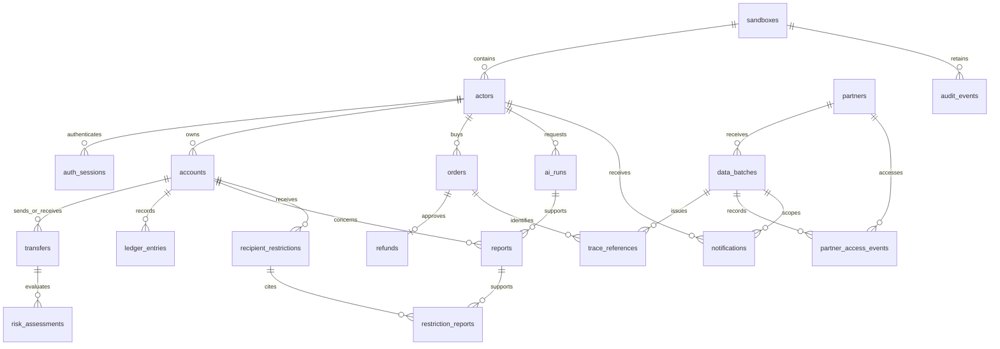

# Guardian data model and transaction rules

The [field-level database specification](database-specification.md) describes every column of all 19 tables, including type, nullability, default, keys and purpose. This document defines the ERD and behavior spanning those records.

`schema.sql` is the baseline DDL for PostgreSQL 16+. Convert it into an initial Alembic migration. The SQL file is independently executable in an empty database. All UUIDs are server-generated except client request keys. All timestamps are UTC timestamptz, displayed in the user's locale. VND uses integer minor units; JSON values are limited to VND 1,000,000,000 per transfer to stay within the frontend's exact-number range.

## Entity relationships

There are 19 tables. This count follows independent lifecycles and traceable relationships. Use JSON for variable model output and assessment details. Monetary state, restrictions, ownership and evidence relationships stay relational.

## Ownership and validation

All tenant-bearing foreign keys include sandbox_id, preventing accidental references to another judge's sandbox. Every query still applies a server-resolved sandbox scope and actor permission. A UUID is an identifier, not a credential. Session ownership must never come from a body/header alone.

- Customer accounts must belong to a CUSTOMER actor. Seeded external recipient accounts can have no actor owner. Services enforce role checks that cannot be expressed through an ordinary foreign key.
- Customer requests can reference only that customer's sender account, order, transfer and analysis run. Report recipient must equal the linked transfer recipient. An order linked to a draft must belong to the same customer.
- Refund account owner must equal order customer, and amount must be within the order's approved original amount. Core has one approved refund per order; partial/multiple refunds need a later schema and accounting change.
- Restriction evidence reports must concern the same recipient, exist in the sandbox and have been reviewed. Actor IDs recording operator actions must resolve to OPERATOR. Old reports remain accessible after a restriction is revoked.
- Issuance/access records are immutable fixtures in core. Customer reports cannot create trace-reference records. Anyone may copy a reference from a screenshot, so a match alone is not an authenticated statement about the sender.
- Notification recipients are derived from distinct customers owning orders in the selected batch's trace references. The operator cannot supply an arbitrary customer-ID list.

## Money and locks

`balance_vnd` caches posted ledger balance. `reserved_vnd` caches the sum of active transfer reservations. Available funds are balance minus reserved. Opening funds get an OPENING ledger entry. Historical fixture transfers get matching sender/recipient entries and corresponding balances. Never seed balances disconnected from the ledger.

Use one consistent lock order. Read immutable resource identifiers without locking first. For confirmation acquire the recipient-restriction advisory lock using a stable namespace/hash. Next lock all affected account rows in sorted UUID order. Finally lock the transfer/refund rows in sorted UUID order and revalidate ownership/state. Restriction create/revoke acquires the same recipient advisory lock before changing status. Cancel, expiry and refund settlement also acquire account locks before resource locks. No operation obtains a recipient advisory lock after locking accounts.

An assessment reads consistent current facts. Confirmation locks the sender and recipient accounts, reconciles due sender reservations by locking their transfer rows in sorted order, and obtains a fresh snapshot. Include the current transfer in that sorted row set. Account reads use the same sender-account-first expiry routine before returning available funds. Because every writer acquires account locks before transfer locks, cancellation and the sweep cannot reverse this ordering. Serialize account math and never debit an amount reserved for another transfer.

### Confirm from DRAFT

1. Verify sender ownership, immutable command identity and terminal state.
2. Under the lock order above, recompute behavioral history, active restriction and rule version.
3. A current HOLD reserves the amount if available, sets RISK_HELD, held_at and a deadline 15 minutes from now. Acknowledgement cannot bypass it.
4. A current WARN requires an assessment ID belonging to this transfer, still under five minutes old, whose fingerprint matches current relevant facts. A missing/stale acknowledgement returns 409 plus the assessment, with no funds reserved.
5. For ALLOW or acknowledged WARN, require sufficient available funds, write sender debit and recipient credit, update both balances and mark SUCCEEDED in one transaction.

For already SUCCEEDED, return the stored transfer without assessing or writing again. For an existing RISK_HELD, return the hold. For CANCELED, REJECTED or EXPIRED, respond 409. Rollbacks leave status, balances, reservations, audit and ledger consistent.

### Confirm from READY

The amount is already reserved. Operator clearance is bound to `cleared_restriction_id`. It only overrides that exact immutable restriction. A new restriction causes RISK_HELD with no additional reservation and no extension to the original hold deadline. A revoked/expired original restriction no longer needs an override. Independent behavioral warnings still require a current acknowledgement. Execution reduces sender balance and reservation together, credits recipient and writes the two ledger entries once.

### Cancel, reject and expiry

Lock the sender account and then the transfer in the defined order. For RISK_HELD/READY, release reserved_amount_vnd exactly once. Set the terminal state, zero the reservation and audit the reason. Repeated same-terminal cancellation/rejection returns the existing result. If another terminal action won the race, return 409 with current state. Expiry is based on database time. Periodic cleanup, account reads and command preflights reconcile due rows. A reservation remaining physically stored after its deadline never authorizes execution.

### Refund settlement

The demo controller settles an existing APPROVED refund. Lock account then refund; check same sandbox, approval and account ownership. Credit once, set SETTLED and append audit. The unique refund ledger key protects retry. An outgoing hold does not prevent an incoming refund. This is a controlled fixture event, not an external payment API integration.

## Restriction consistency

At most one restriction row is ACTIVE per recipient. Before adding a replacement, lock the recipient restriction key, mark time-expired rows EXPIRED, and return 409 if another non-expired ACTIVE row exists. Replace a decision by revoking it then creating a new immutable decision in the same service transaction when the UI supports replacement. Core may expose two explicit actions and show the intermediate state. Confirmation takes the same advisory lock so its decision is ordered against restriction changes.

Expiry matters even if the stored status still says ACTIVE. Queries always require status ACTIVE AND expires_at > database time. The seeded restriction expires within the sandbox lifetime. Approving one transfer does not revoke the restriction for other customers.

## Idempotency

- New drafts use `(sandbox, sender, client_request_id)`. Identical fields replay with 200; different amount/recipient returns 409.
- Analyses and reports use `(sandbox, actor, client_request_id)` and compare original submitted fields/content digest on replay. Reused keys with different payloads return 409.
- Terminal transfer/refund actions use the resource ID. Ledger uniqueness is the final duplicate-write guard.
- Notifications use `(sandbox, source_report, batch, recipient_actor)`. Repeating publication returns existing recipients/counts.
- Restriction creation is protected by the active-per-recipient index. Repeated revoke returns the existing revoked row.

## Retention and access

Expire sandbox credentials at 24 hours. Delete expired sandboxes and private evidence after a configurable 24-hour grace period. All tables cascade with sandbox deletion. Before deleting a sandbox, enumerate its evidence keys, delete private objects with a retryable cleanup record/log, then delete data. Operational logs contain only redacted event information. Implement tests in a dedicated database, with no real credentials or production evidence.

The application role permits appends to ledger/audit, with no routine UPDATE/DELETE on those tables. A separate migration/cleanup owner handles schema changes and expired sandbox deletion. Corrections create compensating entries. Do not create silent balance edits in application endpoints.

## Model-result JSON

`ai_runs.output` stores validated provider output, any citation validation failures, original transcription and customer finding derived with official backend facts. Persist provider/model/prompt version, timestamps and error_code for evaluation. `input_digest` is SHA-256 of canonical submitted fields plus original image bytes, or the canonical grouping request including the root report ID. It distinguishes an exact logical retry from changed client input. Persist the selected grouping source IDs/text in input_text as a canonical snapshot. A replay reuses that snapshot; newly received reports do not alter an existing run. A later model version creates a new run. `risk_assessments.facts` records the median, sample count, threshold, active restriction ID and input fingerprint without copying full confidential histories into model prompts.
