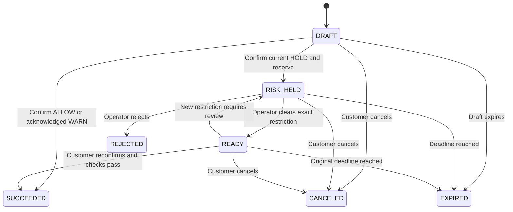

# Guardian product requirements

## Problem and outcome

A customer can authorize a legitimate-looking transfer while being deceived about its purpose. A small payment can be fraudulent. A large unusual payment can be legitimate. Recipient reports can contain useful evidence, duplicated screenshots or unsupported accusations.

Guardian provides recipient warnings, transaction-anomaly warnings and optional screenshot verification before money leaves a synthetic wallet. Operators investigate submitted evidence, trace a reference to internal issuance/access records, and approve recipient restrictions and targeted customer notices.

Success means a judge can change the evidence and observe a correspondingly different decision. The first customer in the main story is protected by a pre-existing, operator-verified recipient restriction. A wholly new recipient and an ordinary transfer can remain undetected when the customer supplies no external context.

## Users and screens

| Role | Screen | Authorized actions |
| --- | --- | --- |
| Customer | Transfer and refund context | See own account, drafts, orders, refunds and notices; assess, confirm or cancel own transfer; analyze an image; submit a report |
| Operator | Reports, evidence and reviews | Read sandbox reports and trace evidence; resolve reports; create/revoke restrictions; approve/reject held transfers; publish batch notices |
| Demo controller | Scenario toolbar | Create a new isolated sandbox, choose a seeded actor, settle a seeded approved refund |

The customer screen contains a balance/available-balance summary, transfer form, risk result, optional screenshot action, refund context and notices. A separate full customer dashboard is unnecessary. The operator screen contains report and hold queues and a detail drawer/page. The detail view includes source evidence, trace matches, recipient decision and notice preview.

## Functional requirements

| ID | Requirement and acceptance condition |
| --- | --- |
| G01 | A new demo creates isolated actors, accounts and fixtures. Two independent browser sessions cannot list or mutate each other's records. Selecting an actor requires the controller credential for that sandbox. |
| G02 | A customer creates a positive-integer VND transfer to a seeded recipient. The backend supplies the recipient identity. Inaccessible or foreign-sandbox IDs return 404. |
| G03 | Assessment returns independent behavioral and recipient signals. A normal amount to a `HOLD` recipient returns `HOLD`; a large anomaly to a recipient with no restriction returns `WARN`. |
| G04 | The initial behavioral rule uses the last 30 days of settled outgoing transfers. With at least five observations, flag an amount at least three times the median AND at least VND 2,000,000. Below five observations return `INSUFFICIENT_HISTORY`. Record the rule version and inputs. This threshold is a contest assumption. |
| G05 | Assessment uses the most severe currently active recipient restriction. A recipient's bank code, account identifier and verified display name are distinct fields. A report count never directly changes the recipient restriction. |
| G06 | Confirm executes current server-side rules. For a warning, require acknowledgement of an unexpired assessment with matching current facts. A stale acknowledgement returns 409 and fresh assessment details. A hold takes precedence over acknowledgement. |
| G07 | A successful transfer atomically debits the sender and credits the synthetic recipient once. Repeated confirmation returns the existing result. Insufficient available funds returns 409 without an overdraft or partial ledger write. |
| G08 | A hold reserves the amount without posting a debit. Show status, reason, expiry, available funds, cancellation and a support/review state. Cancel/reject/expire releases the reservation once. |
| G09 | Operator clearance changes a held transfer to `READY` and records actor, reason and the exact restriction being overridden. The customer must confirm again. A new or changed recipient restriction invalidates the old clearance. The original hold deadline remains in effect. |
| G10 | A customer submits an image or text to analyze, optionally linked to one owned draft and one owned order. Amount/order/fee facts come from backend records. A missing fee is unknown. A consistent message never certifies a sender as legitimate. |
| G11 | AI returns requested action, claimed purpose, source excerpts, extracted references, missing information and a `MISMATCH`, `CONSISTENT` or `UNCERTAIN` finding. Persist model status separately from user decisions. A timeout returns verified transaction facts and an explicit unavailable/inconclusive result. |
| G12 | Reporting creates a review item referencing owned evidence. It does not create an active recipient restriction. Reports support `RECEIVED`, `IN_REVIEW`, `RESOLVED`, `DISMISSED`. RECEIVED may move to any of the other states; IN_REVIEW may resolve or dismiss. RESOLVED and DISMISSED are terminal. Repeating the same review is idempotent; a different terminal decision returns 409. |
| G13 | Operator analysis proposes related reports with quotations and rationale. The backend validates every referenced report and source excerpt. Invalid citations are dropped and the result is flagged for review. |
| G14 | Trace exact extracted references against issuance records. Show the reference, batch, issuing partner, access events, candidate customers and limitations. No match and missing codes are supported results. Similar language alone cannot identify a data source. |
| G15 | Operator decisions require evidence IDs, reason, expiry and an action of `WARN` or `HOLD`. Restriction history is retained. Revoke/create writes a new audited decision, not a silent overwrite. A wrong restriction can be revoked. |
| G16 | For a batch supported by trace evidence, show notice recipients before publishing. Publication requires operator approval and creates one notice per affected customer. An unrelated customer receives none. Notices describe a precaution and official next steps, without naming a partner as a proven offender. |
| G17 | A seeded approved refund can settle once through demo controls. Credit proceeds while an outgoing transfer is held. Order fee data and approval fixtures have provenance labels. |
| G18 | Image files, notes, trace records and provider keys have server-side access controls. Prompt content is treated as untrusted evidence. AI has no general SQL, shell, money-movement or policy-change tool. |

## Risk presentation

`ALLOW` means no configured intervention was triggered with the available evidence. Use customer copy such as “No additional warning identified.” `WARN` shows specific reasons and provides Cancel/Continue controls. `HOLD` indicates a pending review, funds reserved, deadline and cancellation. Never display “Guaranteed safe.”

Recipient findings and behavioral reasons remain separate in the response. A behavioral warning does not label a merchant fraudulent. The primary video uses a verified `HOLD` recipient; the anomaly branch remains available on the live product.

## Transfer state machine

A draft expires after 30 minutes. A first hold creates a 15-minute review deadline. A state becomes expired before any later command is applied when its deadline has passed. Browser countdowns are informational. The server owns time. Background cleanup updates expired reservations, and money-reading/writing endpoints reconcile due holds before returning available funds. Cleanup failures must not let an expired transfer execute or keep a displayed available balance stale.

## Quality requirements

- Monetary operations use database transactions, account locks, unique keys and integer VND. Concurrent retries, expiry, cancellation and confirmation converge to one outcome.
- A transfer's original sender, recipient and amount are immutable. Editing creates a new draft. Confirmation and cancellation are naturally idempotent by transfer ID; terminal conflicts return 409.
- Assessment has a five-minute lifetime and a fingerprint of relevant current facts. Confirmation recomputes facts. Recipient restriction changes can escalate to HOLD immediately.
- AI calls have a 20-second deadline, at most one transient retry within that deadline, and bounded per-sandbox/global call budgets. Authorization/risk enforcement works when the model is unavailable.
- Preserve raw evidence with restricted access and validated content type. Limit files to 5 MiB and reject unsupported formats. Never fetch arbitrary URLs from evidence in core scope.
- Session cookies are HttpOnly/Secure in production. Mutations require CSRF verification and an allowed Origin. Never accept role or sandbox ownership from an unverified header.
- Preserve Vietnamese and English locale parity using Nemo's existing i18n workflow. All planning and API identifiers use English. Primary customer demo copy is Vietnamese.
- Measure actual latency in the deployed app. Aim for ordinary transfer operations within two seconds excluding cold starts and provider analysis. Report observed values rather than promising unmeasured production throughput.

## Delivery scope

Core includes two roles/screens, three independent demo scenarios, synthetic wallet transfers/refunds, warnings and bounded holds, image/text analysis, reports, exact-reference tracing, operator recipient decisions, targeted notices, audit and evaluation.

Post-contest extensions include automated many-report clustering beyond the small operator batch, partner suspension, full policy replay, native mobile integrations, external payment settlement, trained behavioral models and live threat feeds. See the expansion document for their dependencies.
